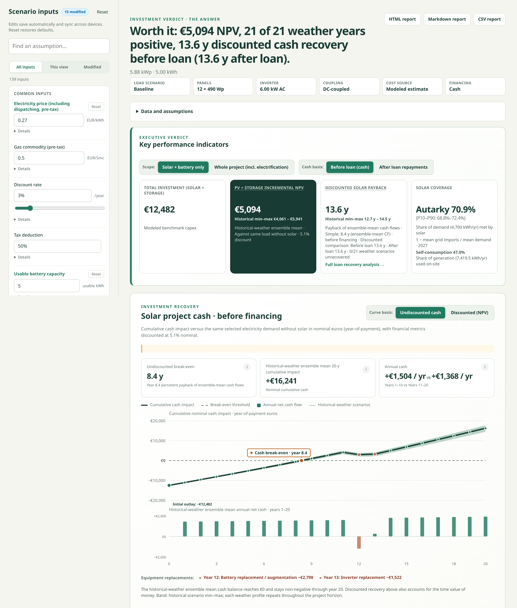
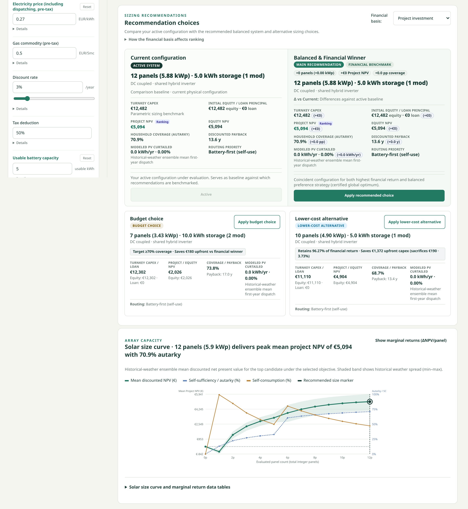
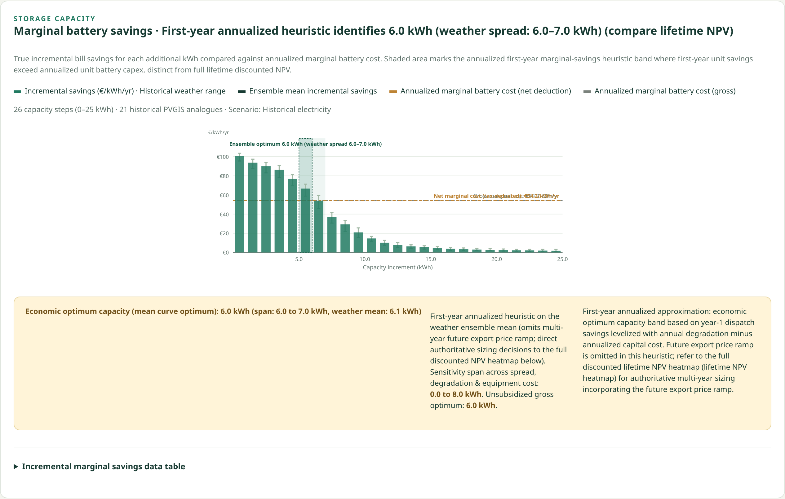
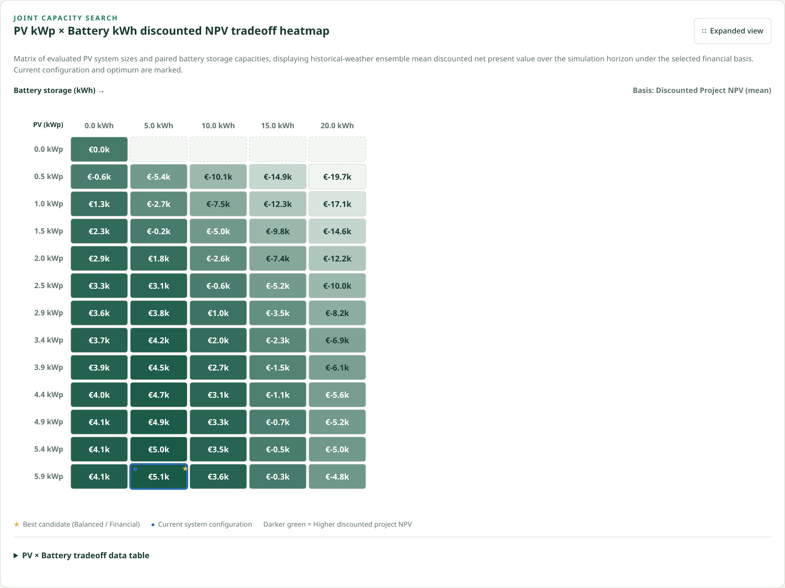
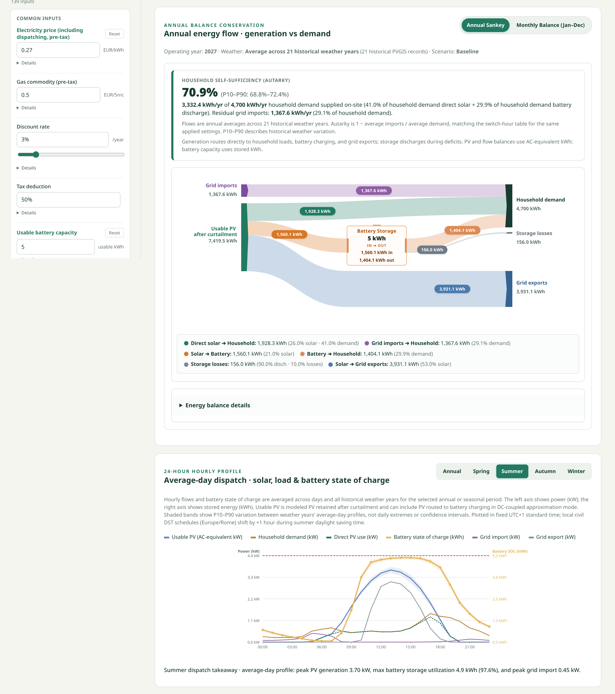
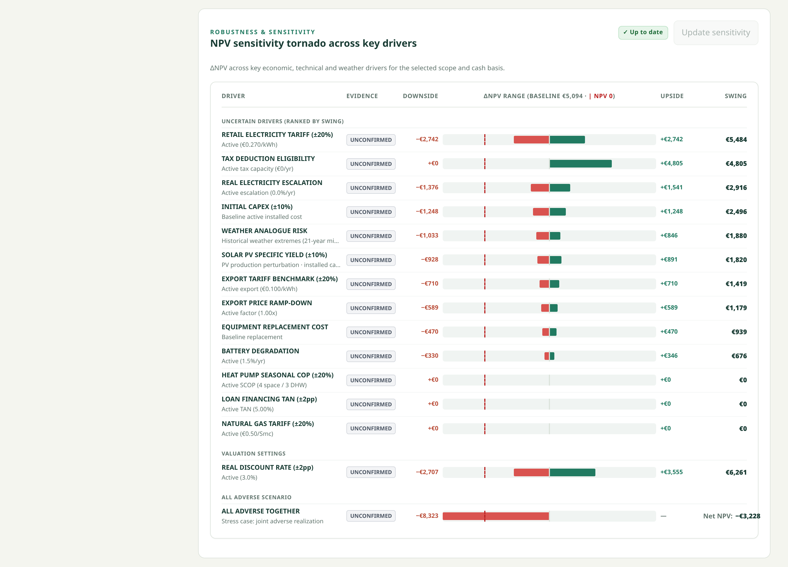
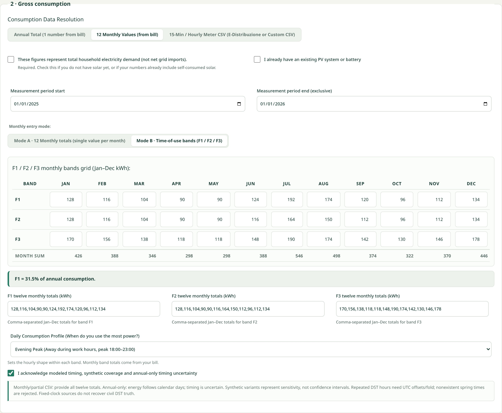
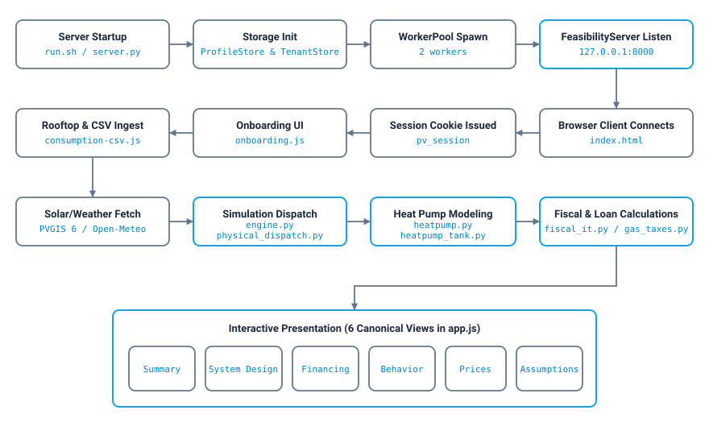

<p align="center"></p>

# PV Lab

**PV Lab** (`pv-lab`) is a local-only scenario calculator for photovoltaics, battery storage, and heat pump electrification in Italian households under `Europe/Rome` timezone rules. It is source-available (not open source) and runs on your own machine, with no hosted service or telemetry; solar and weather data requests contact external providers when authorized. Users enter coordinates, manual or multi-segment roof geometry (up to 12 orientations), and electric baselines—or import official 15-minute or hourly Italian distributor consumption CSVs—through a responsive browser interface. The engine runs multi-year 8,760/8,784-hour physical dispatch simulations combining PV production, battery storage with degradation and losses, and hydronic heat pump demand (space heating with weather-compensated radiator curves and stratified domestic hot water storage). Economic views cover F1/F2/F3 time-of-use tariffs, the PUN market catalog, regional gas excises, PMG export compensation, VAT, and financing cash flows across six interactive views.



## Supported platforms and requirements

* **Operating systems**: Linux (tested on Linux `x86_64`), macOS (Apple Silicon `arm64`, requiring Homebrew `python@3.12`; native verification pending), and Windows `x64` (verified on Windows 11 Enterprise 26H2 `x86-64` with native ACLs).
* **Python**: `Python >=3.12, <3.13` (CPython 3.12 required).
* **Browser and JavaScript**: Client-side Vanilla ES2022+ in modern browsers (Chrome, Firefox, Safari, Edge). Node.js `24.22.1` is required to run the browser UI test suite.
* **Storage**: Persistent user profiles, uploads, and the SQLite database (`PV_DATA_ROOT`) must reside on a local filesystem that supports owner-only POSIX permissions (`0700`) or native Windows ACLs, without symlinks or reparse points.

## What you can do with it

* **Push back on oversized battery quotes**: Evaluate the marginal annual bill savings of each additional kWh of battery capacity against its annualized installed cost (`battery_sizing`), and inspect the full PV-versus-battery discounted NPV tradeoff matrix across all historical weather years.

  

  

  

* **Size multi-orientation rooftops**: Model up to 12 roof orientations with custom tilt, azimuth, panel wattage, and shading fractions, or fetch solar irradiance and ambient temperature data from PVGIS 6 (SARAH-3) and Open-Meteo ERA5 to compare normalized yield by roof plane.

* **Simulate hourly physical dispatch and hydronic heat pumps**: Execute Numba-accelerated 8,760/8,784-hour simulations (`dispatch_physical_year`, `simulate_shared_heat_pump`) that pair AC/DC-coupled battery routing and degradation with air-to-water heat pump performance maps (not tested and probably a bit rudimentary), EN 442 radiator output scaling, weather-compensated flow curves, and domestic hot water tank storage.

  

* **Audit Italian tariffs, gas taxes, and sensitivity**: Evaluate ARERA F1/F2/F3 time-of-use bands, GME day-ahead market price catalogs, progressive statutory gas excise brackets and regional surcharges, tax deductions, and LCOE, and test robustness across 14 NPV drivers (`summary_sensitivity`).

  

* **Compare cash vs. loan financing and audit every input**: Solve for optimal loan principals (`solve_loan_amount`), compare 20-year discounted cash versus loan trajectories with mid-life inverter and battery replacements, and inspect a traceable input ledger across all six canonical views (`Summary`, `System Design`, `Financing`, `Behavior`, `Prices`, `Assumptions`).


*Illustrative scenario; results depend on the entered costs, consumption, weather and tax assumptions.*

## Motivation

* **Push back on inflated installer quotes**: Installers frequently pitch astronomical battery capacities—and consequently bloated turn-key quotes—justified by rough annual averages. I built PV Lab to test those claims against hourly physical reality and show the true marginal return of each additional kWh of storage.
* **Model real Italian billing and physics**: Accurately sizing photovoltaics, batteries, and heat pumps in Italy requires modeling `Europe/Rome` daylight saving transitions, ARERA F1/F2/F3 bands, progressive gas excise brackets, and GME export pricing across multi-year historical weather ensembles.

* **Keep household data local**: Interval meter readings, roof coordinates, and utility bills belong on your own machine, so the calculator runs locally with no cloud service and no telemetry.

## AI development disclosure

This software was built with assistance from AI coding agents, with humans leading the architecture, physical and fiscal modeling, testing, and code review.

## Acknowledgements

PV Lab relies on the following open-source libraries and data providers:

* **Python and numerical computing**: [Python](https://www.python.org/) (CPython 3.12), `numpy==2.5.3`, `numba==0.68.0` (with `llvmlite`), and `scipy==1.18.1`.
* **Security, timezones, and packaging**: `defusedxml==0.7.1`, `tzdata==2026.6`, `hatchling==1.33.0`, and `uv 0.12.1`.
* **Testing and auditing**: `pytest==9.1.1`, `pytest-xdist==3.8.0`, `execnet==2.1.2`, `pip-audit==2.10.1`, and Node.js `24.22.1`.
* **Optional legacy tooling**: `rasterio==1.5.2` (used only in offline legacy data preparation).
* **Solar and weather data**: PVGIS 6 (SARAH-3) and Open-Meteo historical ERA5.

## Status

The codebase has passed its automated public gate suite (`tools/check_public_plan.py --mode public`), covering Python unit and integration tests, Node.js browser UI tests, and the six-view acceptance suite (`verify.py`) with zero failures. However, Italian fiscal rules in `feasibility/fiscal_it.py` are provided as compatibility arithmetic and are explicitly marked `current_legal_review_verified=False`. Unless a JSON manufacturer performance map is supplied (`hp_manufacturer_map_json`), air-to-water heat pump simulations use a provisional generic fallback map (`create_provisional_fallback_map`) rather than certified manufacturer test data. Large discrete sizing searches use deterministic coordinate refinement rather than a certified global optimum. Finally, the repository privacy tree scan (`tools/privacy_check.py tree`) must pass on a clean git history prior to publishing.

## The Six Interactive Views

| View | What it shows |
| --- | --- |
| Summary | Investment verdict, cash trajectory and sensitivity. |
| System Design | Compare solar and battery sizes and roof yields. |
| Financing | Compare cash and loan payments over time. |
| Behavior | Explore energy flows and hourly dispatch. |
| Prices | Review electricity, gas, export prices and taxes. |
| Assumptions | Inspect inputs, sources and calibration. |

## Start Here

Clone the repository and enter the directory (the address assumes this is the published repository):

```sh
git clone https://github.com/AntoG00/pv-lab.git
cd pv-lab

```

Install the locked dependencies and package for your platform using CPython 3.12:

| Platform | Prerequisite | Environment & Install |
| --- | --- | --- |
| Linux (`x86_64`) | `python3.12` | See Linux block below |
| macOS (Apple Silicon `arm64`) | `brew install python@3.12` | See macOS block below |
| Windows (`x64` PowerShell) | `py -3.12` | See Windows block below |

**Linux**

```sh
python3.12 -m venv .venv
.venv/bin/python -m pip install --require-hashes --only-binary=:all: -r requirements-dev.lock
.venv/bin/python -m pip install --no-deps --no-build-isolation .

```

**macOS (Apple Silicon arm64)**

```sh
brew install python@3.12
python3.12 -m venv .venv
.venv/bin/python -m pip install --require-hashes --only-binary=:all: -r requirements-dev.lock
.venv/bin/python -m pip install --no-deps --no-build-isolation .

```

**Windows (PowerShell with CPython 3.12 x64)**

```powershell
py -3.12 -m venv .venv
& .\.venv\Scripts\python.exe -m pip install --require-hashes --only-binary=:all: -r requirements-dev.lock
& .\.venv\Scripts\python.exe -m pip install --no-deps --no-build-isolation .

```

Note: `.venv/bin/pip` is omitted in pre-configured environments; always invoke pip via `.venv/bin/python -m pip`.

## Everyday Use

Run the local web server from the repository root:

```sh
# Start the local server on port 8001 via the shell launcher (Linux / macOS)
bash feasibility/run.sh --host 127.0.0.1 --port 8001

# Start the local server with fictional demo data generated in $PV_DATA_ROOT/fictional-demo
bash feasibility/run.sh --demo --host 127.0.0.1 --port 8001

# Launch the Python server module directly
.venv/bin/python -X faulthandler -m feasibility.server --port 8001

```

On Windows, start the server with `& .\.venv\Scripts\python.exe -X faulthandler -m feasibility.server --port 8001`. Open `http://127.0.0.1:8001/` in your browser and stop the server with Ctrl+C.

During onboarding, you can configure monthly F1/F2/F3 electricity consumption or upload distributor interval CSVs, and define thermal electrification end-uses and fiscal parameters:





Additional command-line entry points are available for profile recovery and market price catalog preparation:

| Entry Point | Flags | Purpose |
| --- | --- | --- |
| `feasibility/run.sh` | `--demo`, plus any `feasibility/server.py` flags | Generates fictional test arrays in `$PV_DATA_ROOT/fictional-demo` when `--demo` is set and starts the server. |
| `feasibility/server.py` | `--host` (default `127.0.0.1`), `--port` (default `8000`), `--allowed-host`, `--local-admin-restart`, `--price-catalog` | Runs the local HTTP daemon. Bind to `0.0.0.0` only on a trusted LAN. |
| `feasibility/recover_profiles.py` | `--name` (required), `--tenant` (optional) | Generates a local operator bearer pairing code for a saved household profile name. |
| `feasibility/prepare_market_prices.py` | `--input`, `--catalog`, `--start`, `--end`, `--source-schema` (default `gme-pun-csv-v1`), `--window-start`, `--window-end`, `--publish`, `--replace` | Validates operator-supplied GME archives and builds immutable price catalogs. |

Pass `--help` to any Python CLI entry point for its full argument list.

## Cross-browser household sharing and session recovery

Each browser session normally receives an independent household namespace. Cookies are specific to the hostname: `localhost`, `127.0.0.1`, and a LAN address can each have a different session. Clearing cookies or using a private window can hide saved profiles; the server data remains on disk. If another browser is still linked, use its pairing code to regain access.

To share
profiles and results across browsers on a trusted local network:

1. **Generate pairing code**: In a browser with existing profiles, generate a one-time
   5-minute pairing code in the household UI.
2. **Join from second browser**: Enter the pairing code in the second browser. This
   grants access to all profiles and calculation results in the source tenant and
   replaces the second browser's active session selection, without deleting any existing data.

### Local operator recovery for old sessions

If a browser session is lost, an operator with local OS access to server storage can
generate a pairing code for an existing household profile:

```sh
.venv/bin/python -m feasibility.recover_profiles --name 'Your saved profile name'
```

On Windows PowerShell, run `& .\.venv\Scripts\python.exe -m feasibility.recover_profiles --name 'Your saved profile name'`.

Run the command using the same `PV_DATA_ROOT` as the server, then enter the returned
code in the browser. If multiple tenants match the name, the command displays their
tenant IDs; re-run passing `--tenant <id>` with the desired tenant. This recovery
requires local OS filesystem access to the data root; remote enumeration is not supported.

### Security and operational considerations

- **Bearer secret**: The pairing code is a bearer secret that grants access to the
  entire source tenant during its 5-minute validity window.
- **Unencrypted LAN HTTP**: LAN HTTP traffic is unencrypted; only generate and enter
  codes on a trusted local network.
- **Tenant replacement, not merging**: Pairing switches the browser to the source
  tenant rather than merging profiles or data across tenants.
- **Preserve or recover current tenant**: Users should preserve or recover their
  current tenant before switching, as pairing replaces the active session selection.
- **Original browser session**: The original browser cookie and session remain valid
  and continue to allow access until explicitly revoked.
- **Independent backups**: Pairing does not replace data backups; back up household
  and profile data separately.

## Reporting issues

If a calculation fails in the local web interface, the UI displays a failure notification with a reviewable, sanitized diagnostic report. The report contains safe build/version identifiers and failure classification codes; it strictly omits personal paths, coordinates, household inputs, raw exception messages, and session tokens.

Users who clone from GitHub can report issues easily:
1. Click **Copy bug report** (or **Download bug report**) in the failure card.
2. Click **Open GitHub issue** to navigate to the repository issue tracker.
3. Paste the sanitized report into the bug report template.

## Configuration

### Environment variables

| Name | Default | Purpose |
| --- | --- | --- |
| `PV_DATA_ROOT` | Platform default (`~/.local/share/pv-lab`, `~/Library/Application Support/pv-lab`, `%LOCALAPPDATA%\pv-lab`) | Root directory for persistent user profiles, uploads, and the SQLite database. Must be on a local filesystem with `0700` permissions or private owner-only Windows ACLs. |
| `PV_LEGACY_DATA_ROOT` | `feasibility/data` | Directory containing legacy reference datasets and historical audit files. |
| `PV_PYTHON` | `.venv/bin/python` | Explicit path to the Python interpreter used for child processes or gates. |
| `PV_NODE` | `node` | Explicit path to the Node.js executable (`24.22.1` required). |
| `PV_PRIVATE_ROOT` | `None` | Path to the private reference evidence directory used exclusively in `--mode private`. |
| `PV_TEST_MODE` | `None` | Set to `public` or `private` to select test harness data isolation. |
| `PV_TEST_WORKERS` | CPU count - 1 | Concurrency limit for parallel test execution. |
| `GOOGLE_API_KEY` | `None` | API key for Google Solar API requests in standalone helper scripts (`Solar API/fetch_solar.py`, `tools/google_solar_helper.py`). |
| `NUMBA_NUM_THREADS` | `1` | Enforces single-threaded Numba JIT execution for determinism. |
| `OPENBLAS_NUM_THREADS` | `1` | Enforces single-threaded BLAS linear algebra execution. |
| `OMP_NUM_THREADS` | `1` | Enforces single-threaded OpenMP execution. |
| `MKL_NUM_THREADS` | `1` | Enforces single-threaded Intel MKL execution. |
| `NUMEXPR_NUM_THREADS` | `1` | Enforces single-threaded NumExpr execution. |
| `VECLIB_MAXIMUM_THREADS` | `1` | Enforces single-threaded Apple Accelerate vecLib execution on macOS. |
| `TMPDIR` | System temp (`/tmp` or `/dev/shm`) | Working directory for temporary test profiles outside the git checkout. |
| `NUMBA_CACHE_DIR` | `None` | Cache directory for pre-compiled Numba kernels. |
| `LOCALAPPDATA` | System path | Windows local app data directory root. |
| `XDG_DATA_HOME` | `~/.local/share` | Linux XDG user data root directory. |

On macOS, use a physical path for `PV_DATA_ROOT`; for example, use `/private/var` instead of its `/var` alias.

### Configuration files and defaults

| File / Key | Default / Role | Purpose |
| --- | --- | --- |
| `feasibility/data/user_defaults.json` | WACC `3%`, inflation `2%`, gas heating efficiency `88%`, baseline COP `3.0` | Baseline equipment assumptions, financial rates, and grid tariff components. |
| `feasibility/data/current_scenario.json` | Baseline scenario | Baseline simulation scenario configuration. |
| `feasibility/data/empirical_csud_meta.json` & `feasibility/data/empirical_csud_prices.npz` | CSUD bidding zone | Default empirical Italian market prices and metadata. |
| `feasibility/data/weather-active.json` & `feasibility/data/hourly.npz` | Baseline weather | Baseline active solar generation and outdoor dry-bulb temperatures. |
| `pyproject.toml` | `hatchling==1.33.0` | Project metadata, dependency pins, and locked package lists. |

## Testing

Run the full public verification gate or individual test suites from the repository root. The `/dev/shm` examples below are for Linux; on macOS, omit the `TMPDIR` prefix:

```sh
# Full public gate suite (Python + Node + Acceptance + Public Reference)
TMPDIR=/dev/shm .venv/bin/python tools/check_public_plan.py --mode public

# Single Python test file
PYTHONPATH=feasibility/vendor:tests:. .venv/bin/python -m pytest -q tests/test_<name>.py

# Single Node UI test file
node --test tests/test_<name>.js

# Acceptance verification suite (validates 6 canonical views, element IDs, API consistency, and styles)
TMPDIR=/dev/shm PYTHONPATH=tests:. .venv/bin/python -c "import test_support, runpy, sys; sys.argv=['verify.py', '--mode', 'public']; runpy.run_path('verify.py', run_name='__main__')"

# Privacy tree scan
.venv/bin/python tools/privacy_check.py tree

```

`tools/check_public_plan.py --mode public` orchestrates `pytest` (parallelized via `pytest-xdist`), the Node.js UI test runner, synthetic demo generation, and `verify.py`. Note that `verify.py` must be run with the `test_support` bootstrap as shown above; invoking it directly without an initialized profile context raises `RuntimeError: Runtime is not initialized; explicitly initialize a local profile before computation` by design.

On Windows, the native release smoke check can be run with `& .\.venv\Scripts\python.exe tools\windows_release_smoke.py`.

## Detailed Guides

* [Deployment](docs/DEPLOYMENT.md), [operations](docs/OPERATIONS.md), [privacy](docs/PRIVACY.md), and [fiscal status](docs/FISCAL_STATUS.md).
* [Model and data notes](feasibility/README.md) and [copyright notice](NOTICE).

* [Architecture Diagram](assets/architecture.svg): visual overview of server initialization, client onboarding, weather and price ingestion, physical dispatch, and the six interactive views.
* [Engine Implementation](feasibility/engine.py): hourly physical dispatch, solar and battery sizing sweeps, and scenario cash flow calculations.

* [Physical Dispatch Kernel](feasibility/physical_dispatch.py): Numba-compiled AC/DC routing and battery state-of-charge simulation.

* [Heat Pump Subsystem](feasibility/heatpump.py): performance map interpolation, weather compensation curves, and EN 442 radiator output models.

* [Italian Fiscal Policy](feasibility/fiscal_it.py) and [Gas Taxes](feasibility/gas_taxes.py): electricity billing, export settlement, tax deductions, and statutory gas excise brackets.

* [Market Price Catalog Pipeline](feasibility/prepare_market_prices.py): GME PUN archive ingestion and empirical price window builder.

## Contributing, Commercial use, and License

**Contributing**: Contributions are welcome. By submitting a contribution, you grant the author (`AntoG00`) the right to relicense your work.


**Commercial use and License**: PV Lab is source-available, not open source. It is licensed under the PolyForm Noncommercial License 1.0.0; see [LICENSE](LICENSE) for the full terms. Contact the author through [GitHub](https://github.com/AntoG00) for commercial authorization.

Noncommercial use is permitted under the included license. Commercial use, including customer assessments and paid services, requires separate written permission from the copyright holder.

* A homeowner modeling their own house is **noncommercial use**.
* Using the tool to prepare client quotes for pay is **commercial use** and requires written authorization.
